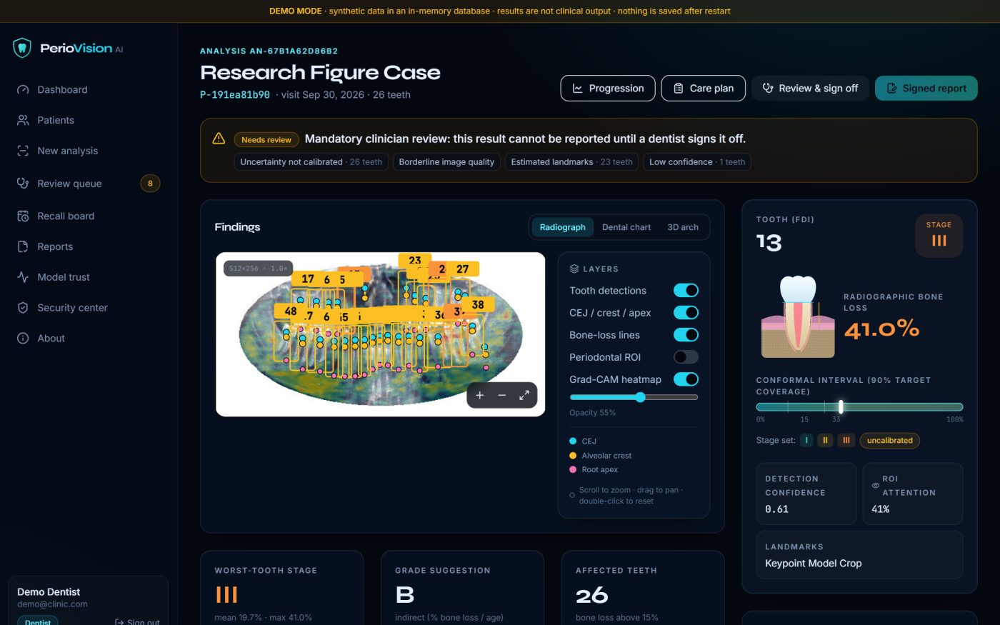
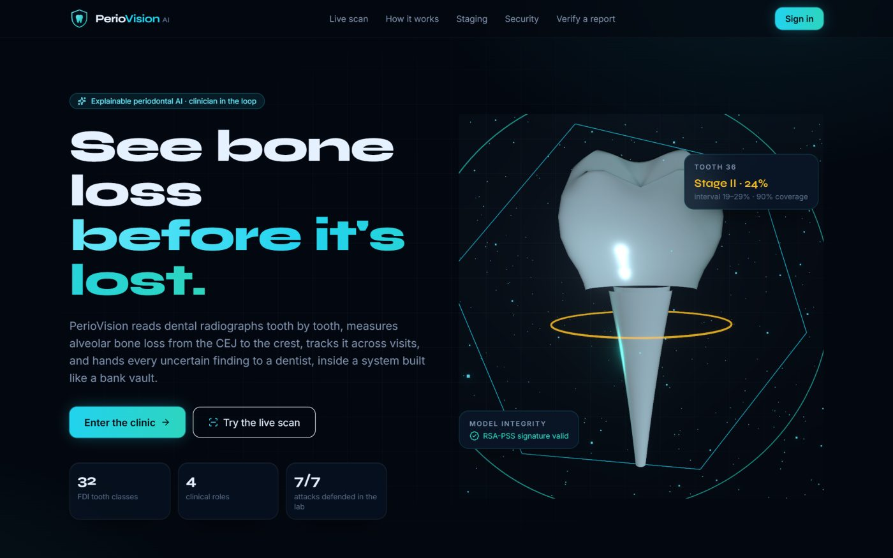
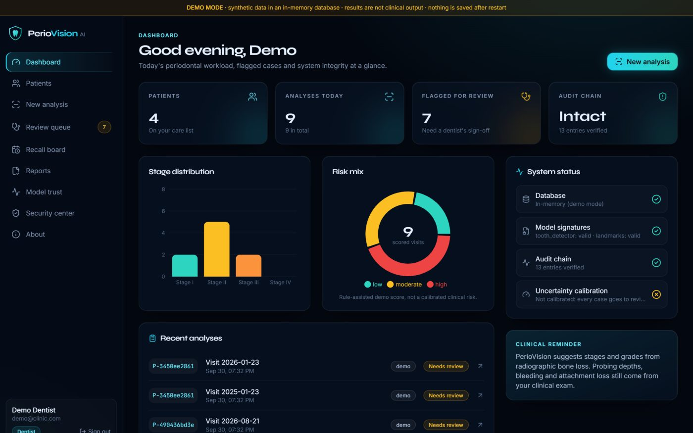
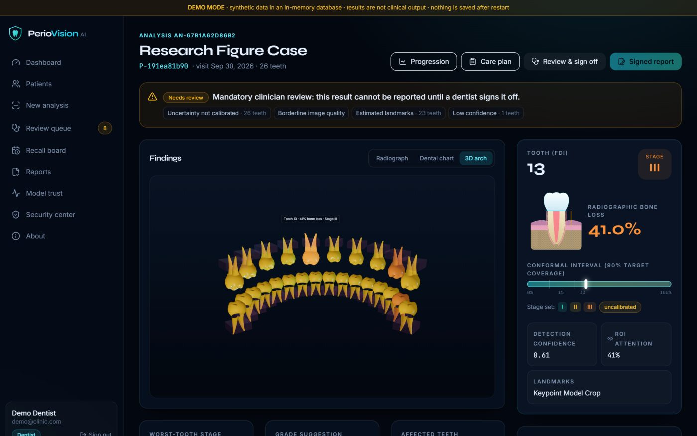
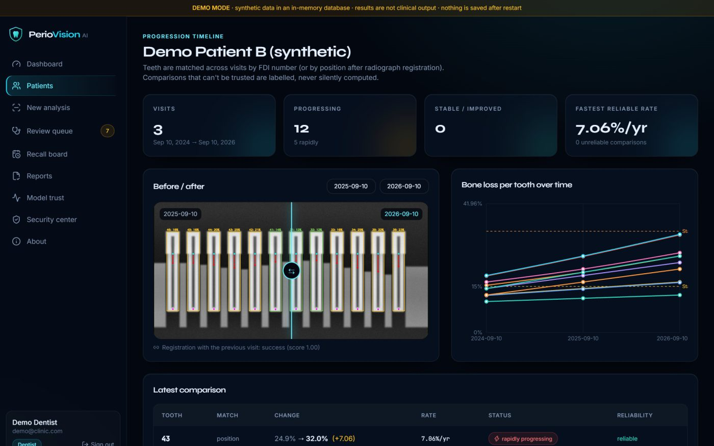
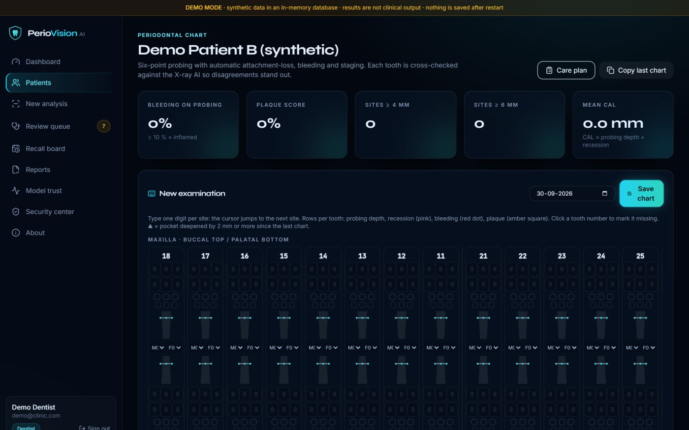
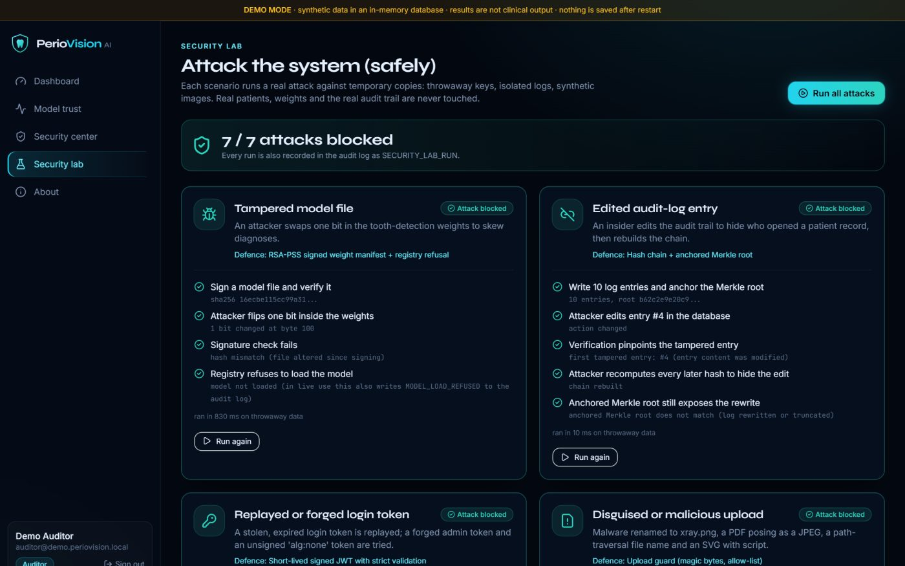

# PerioVision AI

**Secure, explainable AI decision support for periodontal bone loss on dental X-rays.**

PerioVision reads a dental radiograph tooth by tooth. For each tooth it:
- finds the tooth and gives its FDI number;
- locates the cemento-enamel junction (CEJ), the bone crest and the root apex;
- measures bone loss and suggests a periodontitis stage and grade (2017 AAP/EFP);
- tracks the tooth across visits.

Every number comes with an honest uncertainty range. Anything doubtful goes to a dentist, and a signed report can only be
issued after the dentist signs off.

Around the AI sits a security layer built for a cybersecurity thesis:
- AES-256-GCM encryption;
- RSA-PSS signed models and reports;
- JWT login with TOTP multi-factor authentication;
- four roles with Zero Trust checks on every request;
- a tamper-evident, Merkle-anchored audit trail.

> **Decision support with a clinician in the loop.** PerioVision is not a certified medical device. Every accuracy figure below is
> measured on X-rays the models never saw during training. The security controls are *aligned with* HIPAA safeguards,
> not certified against them.



| | |
|---|---|
|  |  |
|  |  |
|  |  |

## The problem and the idea

Periodontitis destroys the bone that holds teeth. Dentists judge the bone loss by eye on X-rays, which is slow, varies
between examiners and is hard to compare across visits. PerioVision turns each X-ray into per-tooth measurements and
says how sure it is about each one. When it is unsure, it says so and hands the case to the dentist. Clinical data
stays encrypted, signed and audited from upload to the signed report.

## How it works

```
X-ray ─▶ quality gate ─▶ contrast enhancement (CLAHE) ─▶ tooth detector (YOLO11m, FDI numbers)
      ─▶ landmark model (YOLO11m-pose: CEJ + crest on both sides, apex) ─▶ bone loss % ─▶ stage I–IV, grade A–C
      ─▶ Grad-CAM heatmap  ─▶ conformal uncertainty interval ─▶ review router ─▶ dentist sign-off ─▶ signed PDF + QR
patient record (age, smoking, diabetes, 8 gum-health questions) ─▶ NHANES risk model ─▶ combined risk level
earlier visit ─▶ registration ─▶ same-site comparison against a calibrated threshold ─▶ stable / progressing
```

| Part | What it does |
|---|---|
| **Detection and measurement (O1)** | Image-quality gate, CLAHE, tooth detection with FDI numbers, two-site landmarks, bone loss %, stage and grade suggestion per tooth |
| **Progression (O2)** | Registration must line up the teeth themselves. A change counts only when the same side of a tooth moves by more than its measured repeatability (2.9–5.4 points) |
| **Explainability (O3)** | LayerCAM-weighted Grad-CAM for all teeth or one selected tooth, plus a check that the model looked at the periodontal region |
| **Uncertainty (O4)** | Adaptive split-conformal intervals with separate calibration for mild and severe teeth, stage prediction sets, and mandatory review when unsure |
| **Risk (O5)** | Logistic regression on CDC NHANES (age, sex, smoking, diabetes, HbA1c, and when answered the 8 CDC/AAP gum-health questions), combined with the X-ray's stage by a documented rule |
| **Security (O6)** | AES-256-GCM with key rotation, RSA-PSS signed models and reports, bcrypt, short-lived JWT, TOTP MFA, lockout, rate limits, four-role permissions, a Zero Trust guard, decoy records, a hash-chained audit log, and a Security Lab with 7 live attack demos |
| **Clinical workflow (O7)** | Login → patient → upload → analysis → review → signed report → audit, in a React app with 3D views. Chairside tools: 6-point perio chart with clinical-vs-X-ray concordance, EFP care plan, patient explainer, recall board |
| **Panoramic films** | Tooth detection and numbering, plus whole-film estimates: bone loss per jaw, and the worst tooth's bone loss and stage. Per-tooth bone-loss numbers are given on periapical films only |

Full design: [docs/ARCHITECTURE.md](docs/ARCHITECTURE.md).

## Results

**In one line:** on unseen periapical X-rays, PerioVision measures bone loss to within **5.5 percentage points** on
average and agrees with the specialist's stage for **80 %** of teeth. Its 90 % uncertainty range really contains the
specialist's value **94 %** of the time, and it sends every uncertain tooth to a dentist.

All results are on held-out data, with 95 % confidence intervals. Full tables are in
[docs/RESULTS_WITH_CI.md](docs/RESULTS_WITH_CI.md) and failure analysis in [docs/ANALYSES.md](docs/ANALYSES.md).

| Task | Result (95 % CI) | Tested on | What it means |
|---|---|---|---|
| Find each tooth with the right FDI number (panoramic, new hospital) | 89.6 % (88.3–90.8) | 250 films from a hospital the detector never saw | About 9 in 10 teeth are found and correctly numbered at a new site |
| Same, after fine-tuning on part of that hospital | **94.5 %** (93.0–95.8) | 96 unseen films, same hospital | The deployed detector |
| Bone loss per tooth (periapical) | **5.48 points** error (4.8–6.2); median 3.45 | 551 teeth, 199 DenPAR test films | The average miss is about 5.5 points of root length |
| Stage per tooth (periapical) | **80.4 %** exact (76.5–84.3) | same | Stage I 91 %, stage II 58 %, stage III 83 %. Severe teeth were called mild only 0.9 % of the time |
| 90 % uncertainty range | covers **93.6 %** (91.4–95.7); severe teeth 91.1 % | same | The stated range can be trusted, including for severe cases |
| Bone loss per jaw (panoramic screen) | AUC 0.85 / 0.87 (0.81–0.89 / 0.84–0.91) | 450 MM-OPG test films | Good at flagging which jaw needs a closer look |
| Worst tooth's bone loss (panoramic) | 11.4 points error (9.4–13.5); 68.5 % stage | 149 patients | A patient-level estimate only |
| Change between two visits (bench) | 95 % of unchanged teeth stay silent; 83 % of 20-point and 63 % of 10-point losses flagged | simulated re-takes, 100 test films | Large changes are caught; real follow-up X-rays are still untested |
| Clinical risk (age, sex, smoking, diabetes) | AUC 0.65 (0.63–0.67) | 3,855 people, a later NHANES survey cycle | Context only; it never overrides the X-ray |
| Same, plus the 8 gum-health questions | **AUC 0.73** (0.71–0.75) | 3,757 people, same later cycle | Used when all eight answers are on the patient record |

How the deployed models were chosen: every candidate was compared on validation data, and the test set was used
once. [docs/TRAINING_INVENTORY.md](docs/TRAINING_INVENTORY.md) lists everything that was trained, including models
that were rejected, such as a root-crop landmark model that was worse on test.

## Run it on your computer (Windows)

1. **Install, once:** [Python 3.11+](https://www.python.org/downloads/) (tick "Add python.exe to PATH") and
   [Node.js 20+](https://nodejs.org/).
2. **Open PowerShell in this folder** and run:
   ```powershell
   .\run.ps1 setup       # installs everything, creates .env with fresh secrets and demo logins (in demo_logins.txt)
   ```
3. **Start the backend** (terminal 1) and **the web app** (terminal 2):
   ```powershell
   .\run.ps1 demo
   .\run.ps1 frontend
   ```
4. **Open http://localhost:5173** and sign in with a login from `demo_logins.txt` (created in this folder by setup).

On macOS / Linux use `make setup`, `make demo` and `make frontend`. The backend runs on port 5000 and its API docs are
at http://127.0.0.1:5000/api/docs. Demo mode keeps data in memory, so everything resets when the backend restarts.

**Five-minute tour:**
1. Landing page: drag the scan bar across the X-ray.
2. Sign in as the **dentist**, then go to Patients → *Demo Patient B*: open Progression, Perio chart, Care plan and Explain to patient.
3. **New analysis:** upload a periapical X-ray and open the result. Switch between Radiograph, Dental chart and 3D arch, and click a tooth.
4. **Review queue:** correct a tooth and sign off. Then generate a **signed report** and verify it on the Verify page.
5. Sign in as the **auditor**: Security center → Verify chain, then Security lab → Run all attacks.

**Tests:**
- Backend: `.\run.ps1 test` (ruff and pytest).
- Frontend: `cd frontend; npm run build; npm run lint`.
- With the trained weights present, `cd backend; python -m pytest tests_live -q` also checks the real models on real X-rays.

## Put it online

| Option | What you get | Guide |
|---|---|---|
| **Full system** on one free Oracle Cloud server (or any Ubuntu server) | Live mode: real accounts with MFA, MongoDB, encrypted storage, signed reports, HTTPS on your own address, nightly backups | [deploy/server/README.md](deploy/server/README.md): `bash deploy/server/setup.sh <your-domain>` |
| **Demo** on Vercel + a free Hugging Face Space | The demo-mode app online, with data in memory | [deploy/README.md](deploy/README.md) |
| **Live mode on your own machine** | Real MongoDB and production keys, behind your own HTTPS proxy | [docs/DEPLOYMENT.md](docs/DEPLOYMENT.md) |

## Retrain or update the models

1. Train on a free Colab GPU with the notebooks in [notebooks/](notebooks/README.md).
2. Install the exported models with `.\run.ps1 install-models -From <export folder>`. It backs up the old models, installs and signs the new ones, and runs the tests.
3. If you use live mode, run `.\run.ps1 resign-prod`.

The app refuses unsigned or altered model files.

## Known limitations

- **Stage II is the weak spot**: it is called correctly 58 % of the time. Its band (15–33 % bone loss) is narrow next to the 5.5-point average error.
- **External validation:** the periapical bone-loss results are from held-out films of the same public dataset (DenPAR). Nothing has yet been tested at another clinic.
- **Panoramic films** get patient-level estimates only. Per-tooth panoramic numbers were not accurate enough against expert grading.
- **Progression** is tested on simulated re-takes. It has not been tested on real follow-up X-rays. Demo patients' trends are planted values and are labelled as such.
- **Risk** comes from questionnaire-type data. It does not read the X-ray, and neither part predicts future progression.

Each of these is listed in [docs/LIMITATIONS.md](docs/LIMITATIONS.md), with what was done about it.

## Documentation

[Architecture](docs/ARCHITECTURE.md) · [Model card](docs/MODEL_CARD.md) · [Results with CI](docs/RESULTS_WITH_CI.md) ·
[Limitations](docs/LIMITATIONS.md) · [Security](docs/SECURITY.md) · [OWASP Top 10](docs/OWASP_TOP10.md) ·
[API](docs/API.md) · [Instructions for use](docs/INSTRUCTIONS_FOR_USE.md) · [Traceability](docs/TRACEABILITY.md) ·
[All docs](docs/README.md)

## Repository layout

```
backend/            Flask API
  app/              api/ routes · services/ workflow · ml/ models, uncertainty, risk · security/ · models/ DB · schemas/
  config/           thresholds.json: every clinical and ML threshold in one place
  research/         evaluation and statistics tools that regenerate every published number
  scripts/          setup, model install and signing, calibration, dataset converters, evaluators
  tests/            fast test suite (no weights needed) · tests_live/: checks with the real trained models
  weights/          signed model files and their held-out metrics
frontend/           React 18 + Vite + TypeScript web app
notebooks/          Colab training notebooks for the deployed models
deploy/             server/ (full online system) · Hugging Face + Vercel demo scripts
docs/               documentation · evidence/ (raw outputs of every evaluation) · reference/screenshots/
data/sample/        synthetic demo X-rays
run.ps1 · Makefile · docker-compose.yml   entry points
```
